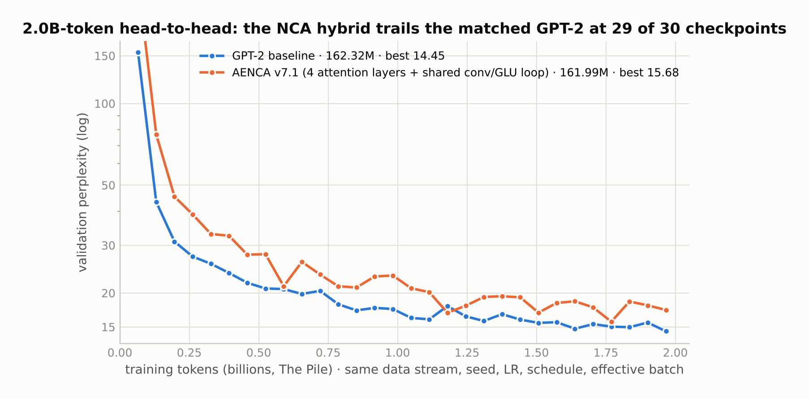
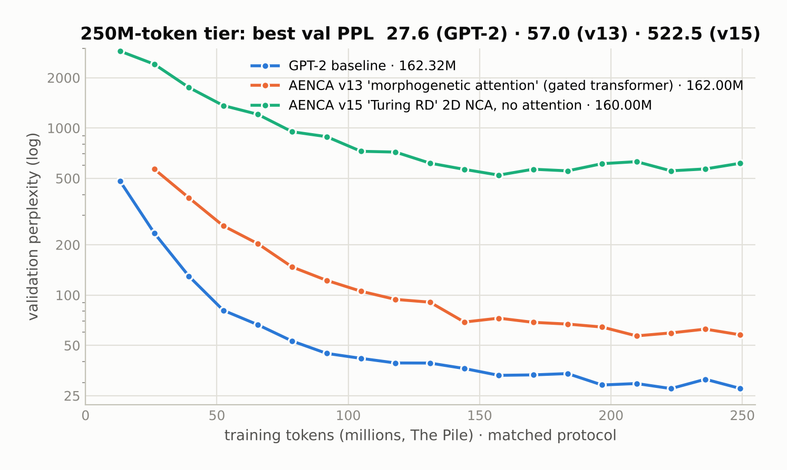
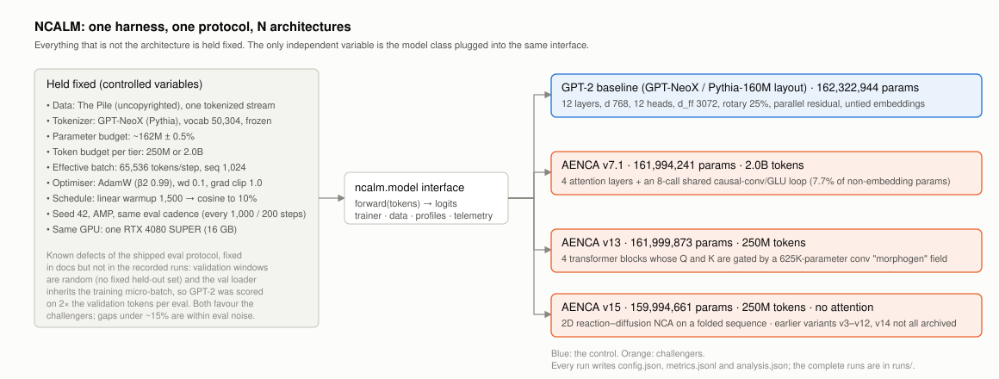

# NCALM — can a neural cellular automaton replace attention? A matched-baseline study at 162M parameters

NCALM is a model-agnostic language-model training harness plus fifteen attempts (AENCA v3 … v15) to replace the attention sublayer of a transformer with an iterated, weight-shared local update rule — a neural cellular automaton. Every challenger was trained under the same protocol as a GPT-2-style baseline of the same size: same tokenized stream of The Pile, same tokenizer, same seed, learning rate, schedule and effective batch, on the same GPU. The baseline was trained at two token budgets, 250M and 2.0B.

**The answer was no.** The only variant that got close to the baseline is 92% transformer by parameter count; the fully attention-free variants landed at perplexities of 369–2,425 against the baseline's 27.6 at the same budget. The archived runs, the harness and the protocol are here so that the comparison can be checked, re-run, or reused for a different architecture.



## Headline numbers

All runs: The Pile (uncopyrighted), GPT-NeoX tokenizer (vocab 50,304), seed 42, 65,536 tokens per step, sequence length 1,024, AdamW (β₂ 0.99, weight decay 0.1, clip 1.0), 1,500-step linear warmup then cosine to 10%, AMP, one RTX 4080 SUPER. Each row below has its `config.json`, `metrics.jsonl` and `analysis.json` in `runs/`.

| Run | Params | Tokens | Best val PPL | Final val PPL | Wall clock | Archived |
|---|---:|---:|---:|---:|---:|---|
| **GPT-2 baseline** (12-layer GPT-NeoX layout) | 162,322,944 | 2.0B | **14.45** | 15.26 | 10.96 h | `runs/gpt2_162m_pile_2b` |
| AENCA v7.1 — 4 attention layers + shared conv/GLU loop | 161,994,241 | 2.0B | 15.68 | 19.84 | 24.69 h | `runs/aenca_v7.1_162m_pile_2b` |
| **GPT-2 baseline** | 162,322,944 | 250M | **27.57** | 28.39 | 1.40 h | `runs/gpt2_162m_pile_250m` |
| AENCA v13 — 4 transformer blocks with conv-field-gated Q/K | 161,999,873 | 250M | 56.98 | 52.88 | 3.23 h | `runs/aenca_v13_162m_pile_250m` |
| AENCA v15 — 2D reaction–diffusion NCA, no attention | 159,994,661 | 250M | 522.5 | 599.7 | 7.72 h | `runs/aenca_v15_160m_pile_250m` |
| AENCA v10 — one shared 4.9M-param rule applied 64×, no attention | — | 250M | 437.1 | — | — | documented only; run directory not retained |
| AENCA v9, v11, v12 — attention-free, 1D substrate | — | 250M | 369–2,425 | — | — | documented only; run directories not retained |

**How to read the 2.0B head-to-head.** The two curves above share every checkpoint step. v7.1 is behind the baseline at 29 of 30 evaluations; its one lead (step 18,000: 16.92 vs 17.92) coincides with an upward spike in the baseline's own evaluation, not a crossing. Comparing single best values (15.68 vs 14.45, an 8.5% gap) flatters the challenger because the validation protocol is noisy (see below); the mean of the last eight evaluations is **17.66 vs 15.16**, a 16.5% gap. Either way, the result is the same: a model that keeps four attention layers and spends the rest of its budget on wider FFNs plus an eight-call shared local rule does not beat twelve attention layers.



## What the challengers were



The harness (`ncalm/model.py`, `trainer.py`, `data/`, `profiles.py`) defines one abstract model interface and one data/eval path; every architecture, including the GPT-2 baseline, plugs into it unchanged. The baseline follows the Pythia-160M layout: 12 layers, d_model 768, 12 heads, d_ff 3072, rotary embeddings on 25% of each head, parallel residual, untied embeddings.

The three archived challengers:

* **v7.1 "Hebbian NCA" (`ncalm/models/v7`)** — four transformer blocks (multi-head attention with RoPE, GLU feed-forward with d_ff 7,464) run as a four-cycle loop; before each cycle, an eight-call loop of a *shared* causal `Conv1d(768→768, k=3)` and a GLU "kernel" updates the state. A PonderNet-style halting head accumulates the readout. Non-embedding parameters: 92.3% transformer, 7.7% the shared local rule. Despite the name, the "Hebbian" gate is `relu(W₁x) ⊙ relu(W₂y)` — a GLU with two inputs — and the halting mechanism never halted early (expected steps was 12.0 at every logged step).
* **v13 "Morphogenetic attention" (`ncalm/models/v13`)** — the same four transformer blocks, with Q and K multiplied elementwise by gates computed from a 625K-parameter dilated-conv "morphogen" field (0.39% of the model). Mechanically it is a gated transformer. The four-rule router inside the field was driven to uniform by its own entropy bonus and never specialised.
* **v15 "Turing reaction–diffusion" (`ncalm/models/v15`)** — the sequence folded into a 2D grid and processed by a reaction–diffusion NCA with no attention anywhere. The purest test of the hypothesis among the archived runs, and the worst result.

v10 — one shared 4.9M-parameter rule applied 64 times with cyclic dilations 2^(t mod 8), depthwise causal-conv perception, no attention — is the experiment the project's title actually describes. Its code is here (`ncalm/models/v10`); its run directory was not retained, so its perplexity (437.1) survives only in a document and is listed as such.

A diagnostic on v14 (`scripts/diagnostics/_diag_v14_dynamics.py`, output in `runs/aenca_v14.1_162m_smoke_20min`) shows what the attention-free failure mode looks like: with attention removed, the state-to-state Jacobian is 0.9973 on the diagonal, 0.0010 and 0.0011 at lags 1 and 2, and exactly 0.0000 from lag 3 onward. The models were not bad sequence models; they had stopped using the sequence. A local rule iterated *K* times has a receptive field, but nothing forces gradient descent to use it, and a zero-init cascade plus a residual update offers a perfectly good local minimum where it does not. The honest conclusion is therefore narrower than "no headroom": weight-shared local update rules showed no headroom *as drop-in replacements for attention under next-token cross-entropy at this scale*, and the failure is plausibly one of optimisation rather than capacity.

## Known defects of the evaluation protocol

Two bugs in the shipped harness affect every number above and were found after the runs:

1. **No fixed validation set.** `ncalm/data` draws fresh random 1,024-token windows from the validation split at every evaluation. The *minimum* over 19–30 noisy evaluations is therefore an optimistic statistic; the baseline's own evaluations swing by ~14% late in training.
2. **The validation loader inherits the training micro-batch size.** The GPT-2 profile uses a larger micro-batch than the challengers, so the baseline was scored on roughly twice the validation tokens per evaluation.

Both effects favour the challengers. Differences under ~15% should be treated as within evaluation noise; the results above survive that margin. Both are ~20-line fixes (a fixed, seeded window list; an explicit eval batch size) and are the first thing to change before reusing the harness. The full protocol, with these caveats prepended, is in [`docs/COMPARATIVE_TRAINING_PROTOCOL.md`](docs/COMPARATIVE_TRAINING_PROTOCOL.md).

## What this repository contains

```
ncalm/                 the harness: model interface, trainer, data pipeline, profiles, telemetry
ncalm/models/gpt2/     the GPT-2 / GPT-NeoX baseline
ncalm/models/v3 … v15  the fifteen AENCA variants, as trained (docstrings reflect design intent at the time; this README is authoritative where they differ)
scripts/               train.py, run_pile_250m_comparison.py, run_pile_2b_comparison.py, chat.py, verification scripts
scripts/diagnostics/   the per-version diagnostic and analysis scripts (Jacobian lag analysis, parameter audits, smoke evals)
tests/                 smoke tests for the variants
runs/                  every complete run: config.json, analysis.json, training.log, metrics.jsonl.gz, eval.csv (runs/index.json is the index; runs/partial/ holds aborted restarts)
docs/                  the comparative training protocol
figures/               the figures in this README
```

Run directories for v8–v12 and for the earlier v5.x SmolTalk2 campaign were deleted before this repository was assembled; numbers from those runs are quoted from the project's documents and marked as such. Nothing here claims more than the archived logs support.

## Reproduce

```bash
pip install -r requirements.txt
python scripts/train.py --profile pile_250m_gpt2 --model gpt2 --seed 42        # ~1.4 h on a 16 GB GPU
python scripts/train.py --profile pile_250m_v13  --model v13  --seed 42        # ~3.2 h
python scripts/train.py --profile pile_250m_v15  --model v15  --seed 42        # ~7.7 h
python scripts/run_pile_2b_comparison.py                                        # the 2.0B tier, both models
```

Profiles are in `ncalm/profiles.py`; the first run tokenizes and caches the Pile stream (set `--data-cache-dir`). A Hugging Face token is only needed if the dataset requires one in your environment.

## What I would run next

Two ablations, about three hours each on the same GPU against the baseline that is already trained, would resolve what the 2.0B result does and does not say:

1. **v7.1 minus the shared conv/GLU loop**, with the freed 6.5M parameters given to the FFNs. If it matches v7.1, the NCA contributes nothing and the interesting finding is the shallow-and-wide attention trade (four attention layers within 16.5% of twelve at matched parameters).
2. **v13 minus the morphogen field**, keeping its four transformer blocks — the same question for the gated variant.

## License

MIT.
